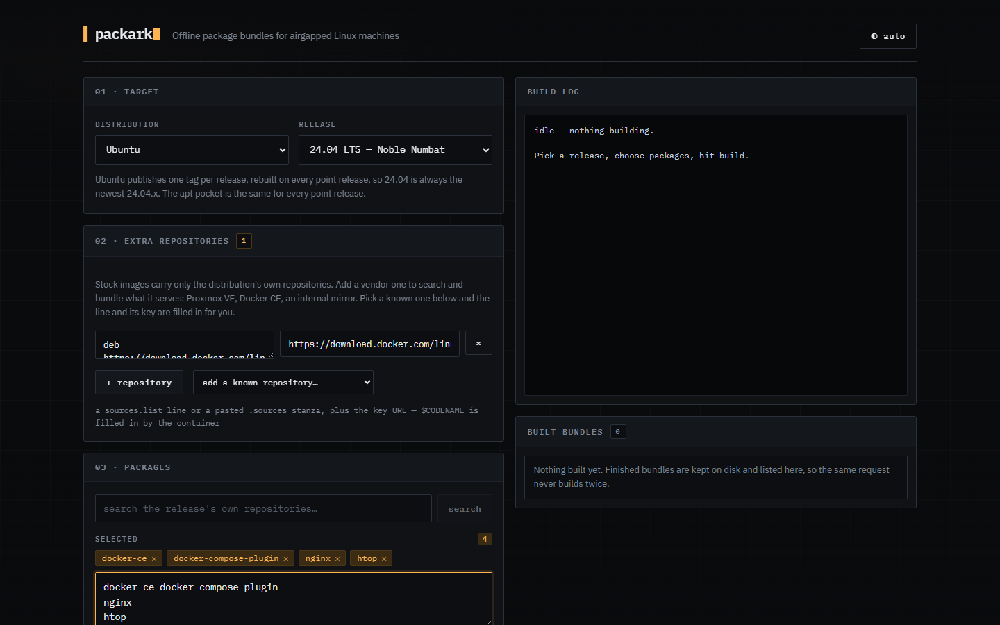
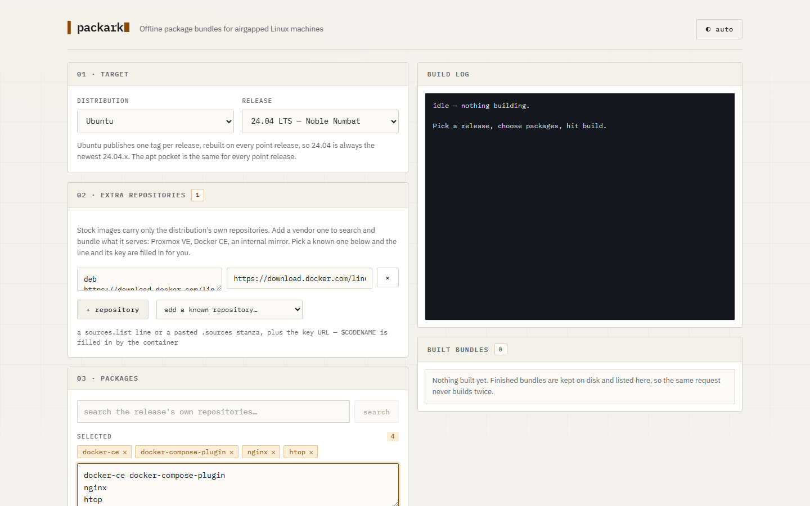
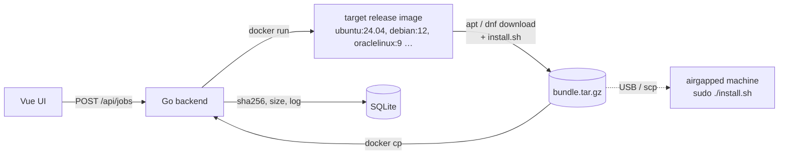

<div align="center">


# packark

**Offline package bundles for airgapped Linux machines.**

Pick a release, pick packages, get one tarball with every dependency and an `install.sh`.


**[Live demo](https://packark.duo-ng.com/)**

[Quick start](#quick-start) · [How to use](#how-to-use) · [Extra repositories](#extra-repositories) · [API](#api) · [On the airgapped machine](#on-the-airgapped-machine)

</div>

<p align="center">
  <picture>
    <source media="(prefers-color-scheme: light)" srcset="docs/screenshots/main-light.png">
    
  </picture>
</p>

<details>
<summary>Light theme</summary>
<br>

</details>

## Highlights

- **Resolves inside the real target image.** Dependencies come out the way the target
  machine would resolve them, not the way your laptop would.
- **Search the release's own repositories.** `apt-cache search` / `dnf search` run in that
  release, so a hit is a package it actually ships.
- **Vendor repositories.** Docker CE, Proxmox VE/PBS/PMG/Ceph presets, or any `.repo` file,
  `sources.list` line or deb822 stanza, with GPG keys verified.
- **Pin versions.** Pick a specific version per package, or take the latest.
- **Cached bundles.** The same request never builds twice; bundles are listed with size,
  date and sha256.
- **EOL releases still work.** Falls back to `old-releases.ubuntu.com` and
  `archive.debian.org` when the mirrors 404.
- **Offline install that does not fight the host.** The bundle is a local apt/yum repository;
  `install.sh` installs by name and takes only what is missing.

## Quick start

```sh
docker compose up --build     # http://localhost:8080
```

> [!WARNING]
> The container drives the host docker daemon through `/var/run/docker.sock`, which is
> root-equivalent on the host. Run it on a machine you trust.

## How it works



## Supported distributions

| Distro | Releases in the picker | Downloads with |
| --- | --- | --- |
| Ubuntu | 26.04, 24.04, 22.04 LTS; the 21.04-25.10 interims; 20.04, 18.04, 16.04, 14.04 ESM | `apt-get install --download-only` |
| Debian | 13 trixie, 12 bookworm, 11 bullseye, their point releases, plus 10 buster and 9 stretch | `apt-get install --download-only` |
| Oracle Linux | 10, 9, 8 and 7, plus every point release Oracle tags: 8.10-8.0, 7.9-7.0 | `dnf download --resolve --alldeps` (7: `yumdownloader`) |

Debian keeps tags for the last few point releases (13.7, 12.15) and codename-only tags
once a release is archived; packark maps 10 and 9 to `buster` and `stretch` for that
reason, and rewrites their sources to `archive.debian.org` when the mirrors 404.

Point releases only exist where the registry has a tag for them. Oracle publishes one
image per point release, so picking 8.9 boots the real 8.9 userspace. Ubuntu rebuilds a
single tag per release on every point release, so `ubuntu:24.04` is always the newest
24.04.x and the apt pocket is identical across them — there is nothing to pick.

EOL releases stay in the list and work: when `archive.ubuntu.com` 404s, the build retries
against `old-releases.ubuntu.com`. Oracle Linux 7 has no dnf, so it falls back to
`yum-utils`.

## Layout

    backend/
      cmd/packark/        entrypoint, env config
      internal/api/       HTTP handlers + embedded frontend (dist/)
      internal/bundle/    job manager, docker run + docker cp, search
      internal/distro/    distro + release whitelist, download and search scripts
      internal/distro/repo.go  extra repositories: validation and per-family setup
      internal/store/     sqlite: built bundles, their checksum and their log
    frontend/            Vite + Vue 3 SFC, builds into backend/internal/api/dist
      public/            favicon.svg + favicon.ico + apple-touch-icon, copied into dist

## How to use

1. Pick the distribution and the exact release you are building for. The build runs
   inside that image, so dependencies resolve the way they will on the target.
2. Add an extra repository if what you need is not in the distribution — see below.
3. Search for the package, or type names straight into the box. Search asks that
   release's own package manager, so a hit is something it really ships.
4. Build. Every package plus its dependencies is downloaded and tarred up with an
   `install.sh`.
5. Copy the tarball over and install it offline.

Building the same packages for the same release a second time does not rebuild: the
bundle is already on disk, and the download starts immediately. Finished bundles are
listed in the UI with their size, date and sha256, and can be deleted from there when
they are no longer worth the disk.

## Searching for a package name

The picker has a search box. It runs the release's own `apt-cache search` or `dnf search`
inside that release's image, so a hit is a package that release actually ships — no
guessing from a name that exists on some other distro. Metadata is kept in a docker volume
per release (`packark-meta-<distro>-<version>`), so only the first search of a release pays
for the refresh; later ones take a few seconds.

A search is a background job, not a request that blocks: the first one for a release pulls
the image and refreshes the package manager metadata, which is minutes with nothing to
look at. The container's progress is streamed into the job log and shown under the search
box, the same way a build's is. The script keeps that progress on stderr and prints only
matches on stdout, so the log can stream while the results stay parseable.

Only the repositories that release enables are searched, which is the honest answer:
Oracle Linux 8 and 9 enable `ol8_baseos_latest`/`ol8_appstream` only, and those ship
podman, not Docker — so `docker` finds nothing there while `podman-docker` does. Oracle
only ever shipped `docker-engine` for OL7, in `ol7_addons`.

Worth it because package names move between distros: Docker is `docker.io` or `docker-ce`
on Ubuntu, never `docker` — `apt-get install docker` gets you a WindowMaker dock applet.

## Where the release list comes from

The lists in `backend/internal/distro/distro.go` are curated: they carry the labels that
say which releases are supported, which are interim, which are archived. No registry
knows that, so the labels stay in the code.

What the registry does know is which tags exist, and that changes under you — Debian
prunes old point releases, vendors publish new ones. So packark reads the tag list at
startup and every 12 hours and merges it over the curated one:

- a curated entry whose tag is gone leaves the picker, instead of failing at `docker pull`
- a version tag nobody has listed yet is added, next to its siblings

Only *recently published* tags are added. A registry keeps every tag it ever served, and
version order cannot tell a release that shipped last month from one that died years ago:
`oraclelinux:6.10` is numerically plausible and was last pushed in March 2021, while
`ubuntu:26.10` was pushed this week. Anything older than 18 months that nobody curated is
left out.

A failed fetch — no internet, a rate-limited registry — is logged and otherwise ignored;
the built-in list keeps working. The footer says which one you are looking at.

## Extra repositories

Stock images carry only the distribution's own repositories, so a vendor package —
Docker CE is the usual one — is not there to find. Add the repository in the UI and both
search and build see it.

The UI ships the common ones as presets, so the line and its key are filled in for you:
Proxmox VE, Backup Server, Mail Gateway and Ceph on Debian (the no-subscription
repositories from <https://pve.proxmox.com/wiki/Package_Repositories>), and Docker CE
everywhere. Anything else is typed by hand in the same two fields.

Oracle Linux takes the `.repo` file vendors publish:

    https://download.docker.com/linux/centos/docker-ce.repo

Ubuntu has no such file, so it takes the `sources.list` line plus the GPG key URL to
verify it with. `$CODENAME` is filled in by the container, so one line works for every
release:

    deb https://download.docker.com/linux/ubuntu $CODENAME stable
    https://download.docker.com/linux/ubuntu/gpg

apt also takes the deb822 `.sources` format, which is what Proxmox documents for trixie
and what a host's own files look like. Paste one or several stanzas into the same field:

    Types: deb
    URIs: http://download.proxmox.com/debian/pve
    Suites: trixie
    Components: pve-no-subscription
    Signed-By: /usr/share/keyrings/proxmox-archive-keyring.gpg

`Signed-By` is honoured: the key you give is written to that path, so the stanza works
exactly as pasted. A stanza that names a keyring the image already ships — the Debian
base repositories do — needs no key of its own.

Pasting a whole host's sources is fine. The base repositories in it are already in the
build image, and apt refuses a source declared twice with a different `Signed-By`
(Debian's image signs `deb.debian.org` with a `.pgp` keyring, a Proxmox host with
`.gpg`), so any stanza whose URI is already configured is skipped, with a line in the
build log saying so. Only the repositories the image lacks are added.

packark downloads the key to `/etc/apt/keyrings/` and rewrites the line with
`signed-by=` pointing at it, so the repository is verified rather than trusted blindly.
Vendors publish keys in both encodings — Docker's is ASCII-armored, Proxmox's is binary —
and apt picks its parser from the file extension, so every key is normalised to a binary
`.gpg` keyring. A binary key left in a `.asc` file reads as *"the repository is not
signed"* on Debian 12 while working on 13, whose apt sniffs the content instead.

Enabling a repository means installing `curl` and `gnupg` into the build image, which
drags in `ca-certificates` and `libssl3`. apt would then treat those as already present
and leave them out of the bundle, and the offline install would fail with *"depends on
libssl3 ... however:"*. So the download resolves against a copy of the dpkg status file
taken before any of that tooling was installed — the image as the target actually is.

These strings end up in a shell script running as root inside the container, so they are
validated hard: an `http(s)` URL of ordinary URL characters, an apt line of the shape
above, or a deb822 stanza whose every field is on a whitelist and whose every value is
checked by kind (`Types` is deb or deb-src, `URIs` are URLs, `Signed-By` is an absolute
path). Nothing that can close a quote or start a second command, and no `$` other than
`$CODENAME` and `$RELEASEVER`. Anything else is a 400 before docker is touched. Bear in
mind what the feature is: you are telling a root shell to trust a third-party repository,
so add repositories you would add to the target machine itself.

A bundle's identity includes its repositories, so the same package list built against a
different repository is a different bundle and gets built rather than served from cache.

## Theme

Dark by default, light available, and "auto" follows the operating system. The toggle is
in the header and the choice is kept in the browser's local storage. Both themes are
built from the same set of CSS variables; the build log and the install snippet stay a
dark terminal in either, because that is what they are.

## Run with Docker (recommended)

    docker compose up --build     # http://localhost:8080

The container carries only the docker CLI; it drives the host daemon through the mounted
socket. That socket is root-equivalent on the host — run this on a machine you trust.

## Run locally

    cd frontend && npm install && npm run build
    cd ../backend && go run ./cmd/packark      # http://localhost:8080

Frontend hot reload: `npm run dev` in `frontend/` (proxies `/api` to :8080).

Env: `ADDR` (default `:8080`), `BUNDLE_DIR` (default OS temp dir).

`BUNDLE_DIR` holds the bundles and `packark.db`, a SQLite file recording each bundle's
packages, size, sha256, build log and date. It is what makes a repeat request a download
instead of a rebuild, so put it on a volume that survives a restart — `compose.yaml`
already does. Deleting the file loses the reuse shortcut, nothing else.

## API

| Endpoint | Does |
| --- | --- |
| `GET /api/distros` | distributions, releases and their picker groups |
| `POST /api/search` | start a search, with optional `repos`; returns a job id |
| `POST /api/jobs` | start a build, or hand back a cached one |
| `GET /api/jobs/{id}` | job status and log; `hits` for a search, size and sha256 for a build |
| `GET /api/bundles` | the 50 newest bundles |
| `GET /api/bundles/{key}` | download one |
| `DELETE /api/bundles/{key}` | drop the row and the file |

`key` is a hash of distribution, release, the sorted package list and the sorted
repository list, so the same request always has the same key.

## On the airgapped machine

    sha256sum packark-ubuntu-24.04-*.tar.gz     # compare against the UI
    mkdir bundle && tar xzf packark-ubuntu-24.04-*.tar.gz -C bundle
    cd bundle && sudo ./install.sh

`install.sh` ships inside every bundle and needs root. Both paths run fully offline; no
repository is contacted.

On Oracle Linux the bundle is itself a yum repository — packark runs `createrepo_c` over
it at build time — and `install.sh` enables just that repository and installs the
packages you asked for by name. That matters: handing `dnf install ./*.rpm` the whole
`--alldeps` tree makes it reconcile every base package against what the machine already
has, and it resolves that by erasing protected ones ("would result in removing: systemd").
Installing by name from a local repository lets dnf take only what is missing. The
repository is declared `module_hotfixes=1`, because modular packages like
`container-selinux` carry a module tag that a bundle has no metadata for.

On Debian and Ubuntu the bundle is a flat apt repository (`apt-ftparchive` writes its
`Packages` index at build time), and `install.sh` points apt at only that repository and
installs the packages you asked for by name. Dependencies the machine already has are
skipped instead of reinstalled, which `dpkg -i *.deb` would do.

## Caveat

Ubuntu and Oracle Linux 7 bundles skip dependencies already present in the base image,
which matches a stock install; for a stripped target, name those packages explicitly.
Oracle Linux 8+ uses `--alldeps`, so those bundles carry the full tree and are
correspondingly larger.

## Adding a distro

One entry in `backend/internal/distro/distro.go`: image name, release list, a tag pattern
for the refresher, and a shell script that drops packages plus an `install.sh` into `/out` and tars it to
`/bundle.tar.gz`. Nothing else changes.
